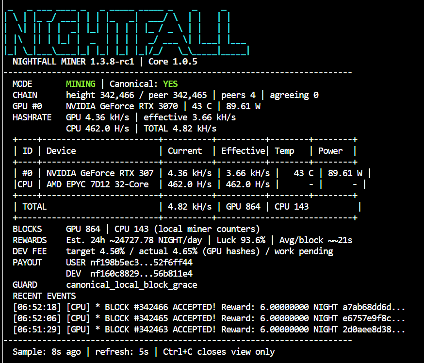

# Nightfall GPU Miner

```text
 _   _ _       _     _    __       _ _   __  __ _                 
| \ | (_)     | |   | |  / _|     | | | |  \/  (_)                
|  \| |_  __ _| |__ | |_| |_ __ _ | | | | \  / |_ _ __   ___ _ __ 
| . ` | |/ _` | '_ \| __|  _/ _` || | | | |\/| | | '_ \ / _ \ '__|
| |\  | | (_| | | | | |_| || (_| || | | | |  | | | | | |  __/ |   
|_| \_|_|\__, |_| |_|\__|_| \__,_||_|_| |_|  |_|_|_| |_|\___|_|   
          __/ |                                                    
         |___/                                                     
```

[]()
[](https://developer.nvidia.com/cuda-toolkit)
[](https://github.com/Instinctes/nightfall)
[](https://github.com/Larppak/Nightfall-GPU-Miner/releases)

**Nightfall GPU Miner** is an independent, high-performance **NVIDIA CUDA + CPU** miner for **NIGHTFALLCOIN (NIGHT)**, built around Nightfall Core v1.0.5. It combines GPU acceleration, CPU mining, multi-GPU support, hardware autotuning, fast synchronization and live monitoring.

**Fees:** 4.5% of GPU hashes to support ongoing development; **CPU mining has no developer fee**. This is an independent community miner, **not an official Nightfall Core release**.

## 🌌 About NIGHTFALLCOIN (NIGHT)

[NIGHTFALLCOIN](https://nightfallcoin.org/) is a privacy-focused, fair-launch Proof-of-Work cryptocurrency with a 90 million NIGHT supply cap. It uses the memory-hard **Nighthash-v2 (Argon2id)** mining algorithm.

[Official website](https://nightfallcoin.org/) · [Web wallet](https://nightfallcoin.org/wallet/) · [Nightfall Core](https://github.com/Instinctes/nightfall)

## 📥 GPU Miner Downloads & Releases

**Release in preparation.** The download will appear on the [GitHub Releases page](https://github.com/Larppak/Nightfall-GPU-Miner/releases) after final compatibility, payout and security checks.

The release will provide a **Linux x86-64 miner archive** and a matching **SHA-256 checksum**. Use the actual miner asset from Releases, **not GitHub's automatically generated “Source code” ZIP/TAR archives**. No miner archive has been published in this repository yet.

## Key Advantages

- 🚀 **High hashrate:** Previously measured RTX 5060 Ti ~5.92 kH/s and RTX 3070 ~4.66 kH/s, versus ~200–400 H/s on standard CPU nodes.
- 🛡️ **Canonical sync guard:** Pauses mining when local chain state cannot be confirmed against peers.
- ⏩ **FastSync & FastState:** Fast bootstrap initialization and optional transfer of a recent trusted chain snapshot.
- 🖥️ **Multi-GPU:** Parallel mining across supported NVIDIA GPUs, with device-specific settings.
- 📊 **Live dashboards:** GPU/CPU hashrate, temperatures, power, blocks, rewards and developer fee status.
- ⚙️ **Autotuning:** GPU batch sizes and CPU thread counts tuned for the installed hardware.
- 💎 **Transparent fees:** 4.5% GPU developer fee, 0% CPU fee, with live fee reporting.

## Hardware Benchmarks

Results below were measured during **earlier v1.3.8 development/mainnet testing**. They are reference figures, **not yet a performance guarantee for the forthcoming protected release**. Speeds depend on GPU model, power limits, clock settings, drivers and mining conditions.

### Multi-GPU

| Configuration | Reported hashrate | Reported GPU power |
| --- | ---: | ---: |
| Dual RTX A4000 (2 × 16 GB) | **8.90 kH/s** | 280 W combined |
| Dual GTX 1660 SUPER (2 × 6 GB) | **8.05 kH/s** | 245 W combined |

### Single NVIDIA GPUs

| GPU | Reported hashrate | Notes |
| --- | ---: | --- |
| RTX 4070 Ti SUPER 16 GB | **9.08 kH/s** | 92 W instantaneous power reading; not a sustained power average |
| RTX 5060 Ti 16 GB | **5.92 kH/s** | Blackwell (`sm_120`) |
| Quadro RTX 5000 16 GB | **5.42 kH/s** | Turing (`sm_75`) |
| GeForce RTX 2070 8 GB | **5.34 kH/s** | Turing (`sm_75`) |
| GeForce GTX 1080 Ti 11 GB | **5.28 kH/s** | Pascal (`sm_61`) |
| GeForce RTX 3070 8 GB | **4.66 kH/s** | Ampere (`sm_86`) |
| TITAN Xp 12 GB | **2.81–5.50 kH/s** | Varies substantially with power limit |

### CPU Mining

| CPU | Reported hashrate |
| --- | ---: |
| AMD EPYC 7D12 | 520–674 H/s |
| Intel Xeon E5 series | 115–635 H/s, depending on model/configuration |
| AMD EPYC 7272 | 358 H/s |
| Intel Core i7 (8th generation) | 258 H/s |

**Measured and estimated data must not be mixed.** Future architecture projections have intentionally been left out of this table.

## 🛠️ Requirements

- **OS:** 64-bit Linux. Exact distribution and native-library support will be listed with the final release.
- **GPU:** Supported NVIDIA card and compatible proprietary driver (check with `nvidia-smi`).
- **CUDA:** The current worker build uses the CUDA Toolkit (`nvcc`) to compile for the installed GPU; release-specific requirements will be confirmed.
- **Wallet:** A public `nf1...` payout address; no seed phrase or private key is required.
- **Rust:** Not required when a compatible prebuilt Core binary is available. Source-building Core may be necessary on some older CPUs or Linux installations.

Windows and AMD GPU mining are not currently advertised as supported.

## Quickstart (once the release is published)

1. Download the miner archive and matching SHA-256 file from [Releases](https://github.com/Larppak/Nightfall-GPU-Miner/releases).
2. Verify the checksum and extract the archive.
3. Open the extracted miner folder and run the installer with your own payout address:

```bash
./install.sh --use-prebuilt --address "nf1_YOUR_PAYOUT_ADDRESS"
```

If the prebuilt Core is incompatible with the machine, follow the release's source-build instructions instead of forcing an unsupported binary. The installer handles CUDA worker preparation, configuration and chain synchronization.

When installation completes:

```bash
mine
minerctl status
minerctl doctor
minerctl blocks 20
```

**FastSync note:** An official chain bootstrap can be initialized quickly, but reaching the current network tip may take longer. With a *recent, verified FastState snapshot already on the machine*, mining can begin much sooner after peer/canonical checks pass. “Mining in one minute” is **not a guaranteed first-install time**.

## 📊 Live Dashboard

Monitor hashrate, GPU temperatures, power, block activity and fee accounting from the terminal with `mine`.



## Command Reference

| Command | Function |
| --- | --- |
| `mine` | Live terminal dashboard |
| `minerctl status` | Mining and network status |
| `minerctl doctor` | Health diagnostics |
| `minerctl blocks 20` | Recent blocks and confirmations |
| `minerctl autotune --apply` | GPU/CPU tuning |
| `minerctl fastsync-info` | Current chain bootstrap / snapshot details |
| `minerctl dev-fee-status` | GPU fee accounting |
| `minerctl restart` | Restart miner services |
| `minerctl web-start` | Start local browser dashboard |

For mixed-GPU rigs, the miner supports selecting devices and configuring their batch sizes separately. Additional settings and troubleshooting instructions will be included in the released package.

## Multi-GPU Setup

Multiple supported NVIDIA GPUs can mine concurrently. Identify the cards with:

```bash
/opt/nightfall-miner/minerctl hardware
```

To select specific devices on a rig, edit `/opt/nightfall-miner/config.env`:

```bash
NIGHTFALL_CUDA_DEVICES="0,1"
# Optional per-device batch sizes for GPUs with different VRAM:
# NIGHTFALL_CUDA_BATCHES="256,128"
```

Then restart with `minerctl restart`. Individual GPU tuning and mixed-GPU operation should be confirmed against the final release's compatibility matrix.

## FastSync & FastState

**Default FastSync:** The installer downloads the official Nightfall chain bootstrap, verifies its SHA-256 and uses it as a trusted historical anchor. Historical blocks through that anchor are not individually reverified locally; subsequent network data is verified normally. The node still needs to catch up to the current chain tip and confirm canonical peer agreement before mining starts.

**FastState (optional):** For repeated deployments or GPU rental rigs, import a recent canonical snapshot from a fully synchronized, trusted Nightfall Miner installation. A compatible miner can export one using `minerctl faststate-create` and import it through the installer's `--faststate PATH` argument. Snapshot creation, transfer and import take time; a fresh snapshot can greatly reduce network catch-up, but fast mining start is not guaranteed.

After installing, useful checks include:

```bash
minerctl canonical-check 180 3
minerctl fastsync-info
minerctl sync-watch 2
```

The canonical guard waits for an acceptable live network state before enabling mining. Do not use arbitrary untrusted snapshots.

## Developer Fee (4.5%)

The developer fee applies **only to completed GPU mining work**. CPU mining remains fee-free. The miner's dashboard reports the target and observed GPU fee percentages and displays USER/DEV payout identities. The displayed percentage may fluctuate slightly around 4.5% over short periods because work is processed in batches.

The protected orchestration component is distributed as a compiled executable; surrounding tools and third-party components retain their respective licensing terms. This design makes casual source extraction more difficult, but no software running on a user's own machine can be considered impossible to reverse-engineer.

## FAQ

**Can I mine on CPU and GPU simultaneously?** Yes. CPU mining and supported NVIDIA GPU mining can run together. CPU has no developer fee.

**Do I need a new wallet?** No. You can use your existing public `nf1...` reward address. Never share a wallet seed or private key.

**Does FastSync mean mining starts in 60 seconds?** Not necessarily. Installation, chain catch-up and canonical network verification can take longer; the fastest route is a recent verified FastState snapshot on an already-prepared machine.

**What if the miner shows `SYNCING_SAFE_WAIT`?** The node is waiting for verified chain agreement. Monitor with `minerctl sync-watch 2` rather than forcing mining on an unconfirmed tip.

## License & Support

- [Repository and documentation license](LICENSE)
- [Protected binary distribution terms — draft for release review](BINARY-LICENSE.md)
- [Changes](CHANGELOG.md)
- [Report an issue](https://github.com/Larppak/Nightfall-GPU-Miner/issues)

The developer fee and independent-project status are disclosed above. Nightfall Core and other bundled dependencies remain subject to their original licenses. This repository will contain **documentation and release links only**; production miner archives will be distributed as verified GitHub Release assets.
